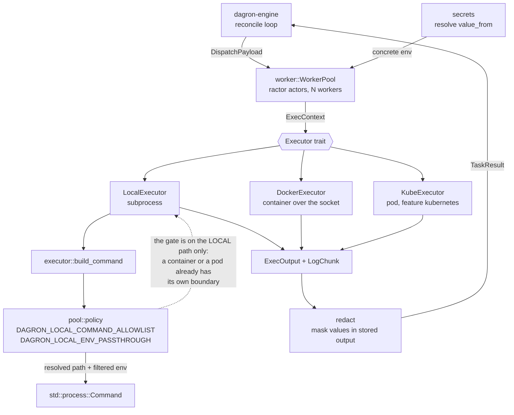
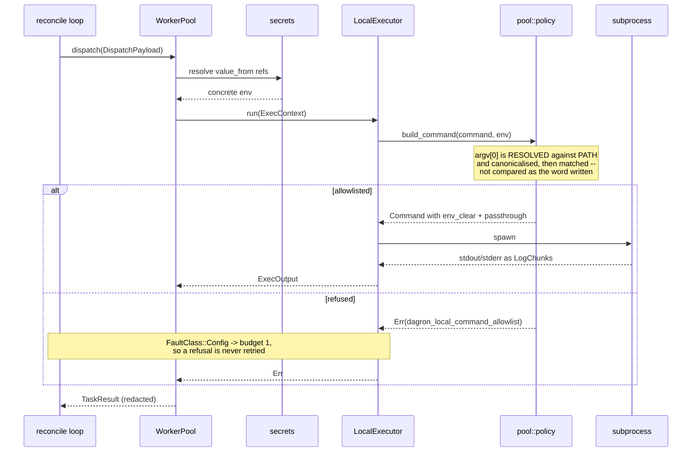

# dagron-executor — task executors and the worker pool

`dagron-executor` defines *how* a claimed task runs. It provides the `Executor`
trait and its Local / Docker / Kubernetes backends, plus the ractor worker pool that
dispatches claimed tasks to the configured executor and reports results back to the
engine's reconcile loop. It borrows core types from `dagron-core` but has no
knowledge of scheduling or ingestion.

## What it does

- **`executor`** — the `Executor` trait and the shared `ExecContext` /
  `ExecOutput` types, plus the always-available `LocalExecutor` that runs each task
  as a subprocess. `LogChunk` carries incremental output for live tailing.
- **`docker_executor`** — `DockerExecutor`, running each task in a container over a
  Docker / podman socket (`bollard`).
- **`kube_executor`** — `KubeExecutor`, running each task as a Kubernetes pod. Behind
  the `kubernetes` feature (pure-Rust client; compiles without a cluster). A task may
  name its own `service_account` (the IRSA seam, so a pod can assume an IAM role), so
  which accounts a task may run under is gated by `DAGRON_TASK_ALLOWED_SERVICE_ACCOUNTS`
  — a comma-separated allow-list, empty by default: a task that names an unlisted
  account is refused rather than run with it, and one that names none runs as the
  namespace `default` (whose token the pod hardening withholds). Never list the
  engine's own ServiceAccount there — it can create pods and read Secrets, so running a
  task under it is a privilege-escalation path. See the module doc for the checks.
- **`worker`** — the ractor `WorkerPool` that dispatches `DispatchPayload`s to the
  executor, records per-task durations into the core `Metrics` registry, and returns
  each `TaskResult` to the reconcile loop.
- **`pool`** — what an `EXECUTOR=local` pool permits: which programs a task may
  run (`DAGRON_LOCAL_COMMAND_ALLOWLIST`) and which of the pool's own environment
  variables it may see (`DAGRON_LOCAL_ENV_PASSTHROUGH`). Both opt-in — unset, a
  local pool behaves exactly as it always has. They exist because a local pool
  runs its tasks as subprocesses of the engine, so `command:` comes from the
  workflow and `Command` inherits the parent environment: on such a pool a spec
  author could run any program the pool's user can and read every variable it
  holds, the datastore DSN included. The allowlist matches a **resolved file**
  rather than the word a task wrote, since a comparison on `command[0]` is
  defeated by a planted program on a task-supplied `PATH`. See the module doc
  for the measurements.
- **`secrets`** — resolves `value_from` env references into concrete values just
  before dispatch. **`redact`** — scrubbing helpers for sensitive output. Note
  what redaction is *not*: it masks values in stored output, and cannot stop a
  task reading a value it was handed. `pool` is the module that stops the
  reading.
- **`install_crypto_provider()`** — installs the process-wide rustls `CryptoProvider`
  the kube client needs before opening TLS (feature `kubernetes`).

## Architecture

One trait, three backends, and a policy gate only the local one passes
through. The engine never names a backend: it hands the pool a `DispatchPayload`
and the pool calls whichever `Executor` was configured at startup.



Note where the policy sits. `redact` masks values on the way *out* and cannot
stop a task reading what it was handed; `pool` is the module that stops the
reading, and it is only meaningful for `LocalExecutor` because that is the
backend with no boundary of its own.

## Event flow

One claimed task, on a hardened local pool. The refusal path is the interesting
one: it happens before the process exists, and it is a *configuration* fault, so
the engine does not retry it.



## Back-pressure

A backend can say "not now" without failing the task. `executor::Backpressure`
is a marker error like `TimeoutError`: the backend returns it wrapped in
`anyhow`, the worker finds it with `is::<Backpressure>()` and sets
`TaskResult.backpressure`, and the engine returns the task to the queue with
its attempt given back. The marker says only that nothing was started: its text
is `not started: <reason>`. Whether the task then waits is the engine's
decision, and where it does not (`DAGRON_QUOTA_WAIT_MAX_SECS=0`, or a `gang:`
member under `RUNNER_GANGS`) that text is the failed attempt's output.

**The contract: return `Backpressure` only when this dispatch created no
workload.** The give-back rests on it. The task goes back to the queue as if
nothing had started, so a workload left behind by a "refused" dispatch runs
with nothing waiting on it, until the task's next dispatch reaps it for its
lower fence. The type also has to reach the worker intact: an error
re-wrapped with `anyhow!("{e}")` is an ordinary failure.

One backend returns it. `KubeExecutor` does when the apiserver refuses the pod
because the namespace's `ResourceQuota` is full:

```text
pods "sched-…" is forbidden: exceeded quota: tenant-quota, requested: limits.cpu=550m, used: limits.cpu=3750m, limited: limits.cpu=4
```

It is recognised on the typed `kube::Error::Api` of the pod create, never on a
rendered string and never on task output: code `403`, reason `Forbidden`, and a
message that starts `pods "<the pod this call named>" is forbidden: exceeded
quota: ` and parses into `requested`, `used` and `limited` lists carrying the
same keys. Every other refusal takes the failure path: the pod and the Secret
are deleted and the error is `create pod '<name>': <the apiserver's error>`.

| Refusal | Why it is not a wait |
|---------|----------------------|
| A request above the quota's hard limit (`requested: limits.cpu=8` against `limited: limits.cpu=4`), or a hard limit of `0` | It can never fit, so waiting cures nothing. |
| LimitRange, `failed quota: tenant-quota: must specify limits.cpu`, PodSecurity, a missing ServiceAccount or PriorityClass, a terminating namespace | No `exceeded quota:` after the pod's name. |
| RBAC (`pods is forbidden: User …`) | It names no pod. |
| An admission webhook's denial, whatever its text says | It does not start with `pods "<name>" is forbidden`. |
| `409`, `429`, `5xx`, a transport error | Not a `403 Forbidden`. |
| A quota refusal whose lists do not parse | The apiserver's wording is not the one this reads. |

One WARN, `quota refusal not treated as back-pressure`, is logged for a quota
refusal that did not qualify: the first row, the last row, and any other `403`
whose message says `exceeded quota`. In practice the third is a message that
does not start with the sentence above, a webhook quoting the phrase included,
and it is where an apiserver that words the refusal differently would show.
That wording has not been captured from a cluster, and a mismatch means no task
ever waits.

A request that fits the hard limit while other pods hold the quota for hours
looks the same in the `403` as one that will clear in seconds. The engine's
bound (`DAGRON_QUOTA_WAIT_MAX_SECS`) is what ends that wait.

On a quota refusal admission stored no Pod, so there is none to delete and only
the task's env Secret is removed. No pod owns that Secret, so its delete is
tried twice, and a WARN names the Secret and the namespace if it may have been
left behind. The worker records no task duration for a back-pressure result,
whether or not the engine goes on to wait, and logs it at DEBUG; the refusal
text goes to the task's output and its live log.

## A lost claim

An execution is told to stop through the signal its dispatch carries
(`ExecContext::stop`, a `Stop`), by whoever holds a clone of it:

- **The engine**, which keeps one for each execution it has out and asks the
  datastore about them at every sweep: a task that was asked to stop (its run
  was cancelled or ran past its deadline, a gang sibling failed), or whose
  claim is another's now. This is what reaches the work within a sweep of a
  cancel, and with no lease heartbeat at all.
- **The worker**, when a lease renewal finds its claim gone.

Ceasing to wait is not stopping the work. Dropping an execution's future ends
a local child (`kill_on_drop`) and nothing else: a container or a pod went on
to the end of its command, with its volumes, and nobody waiting. So the worker
asks first, through `ExecContext::stop` (`Stop`), and waits for the executor
to return before it reports and frees its slot.

**An executor that makes a remote workload hears the stop**, stops and removes
what **this attempt** made, and returns the marker error `ClaimLost`:

| Backend | What it does when asked to stop |
|---|---|
| `LocalExecutor` | drops the run, which kills the child |
| `DockerExecutor` | `stop` on the task's container, with the task's grace; then removes its steps' containers and the checkout's, which mount its workspace by name, and the one that fetches its actions; then the task's own, which, where it made the workspace (no init container did), goes only once its steps' and its checkout's are seen gone and is otherwise killed and left; then its services', the first last; and last, once each of those is seen gone, the container that holds its actions and the init container, whose volumes the task mounted by name, each with its volumes |
| `KubeExecutor` | deletes the pod with the task's grace, removes its env Secret, and waits to see the pod gone |

- **By the names the attempt made**, never by the task's labels: a later
  attempt's workload carries those labels too, and a stalled worker that wakes
  up to a lost claim must not take its successor down.
- **The grace** is the task's `CI_STEP_GRACE_SECS` (`10` s when it names none,
  `600` at most), which is what `dagron-ci-exec` gives a step, and five
  seconds for the runner itself to end.
- **`ClaimLost` says the work was seen gone.** The Docker executor returns it
  once the daemon has said each container is removed, or was not there; the
  Kubernetes executor once the apiserver has said the pod is gone. A removal
  the daemon refuses or does not answer, and a pod still there twenty seconds
  past its grace, are returned as `ClaimLost::unseen` instead: still a lost
  claim (`is::<ClaimLost>()`), which reads "what this attempt started may
  still be running" and why (`TeardownUnseen`). The worker passes it on as
  it is.
- **An executor that never returns** is waited on for twelve minutes (the
  longest grace, and two minutes) and then dropped, as every execution was
  before. The worker then says the same: nothing saw the work stop.
- What keeps a later claim from running beside such a leftover is that
  claim's own dispatch, below.

**The result says what was seen** (`TaskResult::stopped`): `Gone` for
`ClaimLost`, `Unseen` for `ClaimLost::unseen`, and `No` for a result the task
reached by itself. The engine settles a task that was asked to stop on it:
cancelled once its work was seen gone, and left as it is, to be looked for
again, when it was not.

**A teardown alone.** `Executor::teardown` is that second look, for a task
that was asked to stop and whose work nobody is watching: its worker died, or
could not see its own teardown through. The engine claims the task anew, so
that everything it left is an earlier claim's, and dispatches a teardown in
place of an execution (`DispatchPayload::teardown`). Nothing is run.

| Backend | What a teardown does |
|---|---|
| `LocalExecutor` | nothing: a child dies with its execution |
| `DockerExecutor` | stops the task's containers from an earlier claim with the task's grace, removes them, and sees them gone |
| `KubeExecutor` | deletes the task's pods from an earlier claim with the task's grace, and sees them gone |

`Ok` once nothing of the task is left; `Err` while something is or cannot be
seen, and the engine asks again ten seconds later. It is the reap a dispatch
does before it creates anything (below), and nothing after it.

## One attempt, one workload

Every container and pod carries its task's labels: `dagron.dev/task-id`,
`run-id`, `attempt` and `fence`. Before a dispatch creates its workload it
stops and removes any the same task still has from an earlier claim, **and
sees them gone**. A predecessor is told to stop and given the task's grace,
as its own worker would have given it.

While one is still there, the dispatch creates nothing. It returns
`Backpressure` ("an earlier attempt of this task may still be running"), so
the engine puts the task back in its queue with no attempt spent and tries
again in a few seconds. So does a dispatch that cannot ask: a daemon or an
apiserver that will not list the task's workloads has not said they are gone.
A container that takes longer than the reap's twenty seconds to stop, and a
pod that is `Terminating` after five, are waited on from the queue, not from
a worker. This used to be best effort: the dispatch started anyway, beside
what was still stopping.

"Earlier" is by the **fence**, the task row's version once claimed. Every
claim raises it and nothing sets it back, so a strictly lower fence is a
predecessor. The attempt cannot say that alone: a rerun, a retry from the
console and a clear each set it back to 0, and what a cancelled attempt left
running then carried the attempt of the rerun's first dispatch and was left
beside it. A workload with no fence label, made before there was one, is
still judged by its attempt. One whose fence does not parse is left alone.

## Feature flags

| Feature | Effect |
|---------|--------|
| `kubernetes` | Enables `kube_executor` (`EXECUTOR=kubernetes`); pulls in `kube` / `k8s-openapi` / `rustls`. |

## Quickstart

Library only — the engine wires it together. Pick an executor and build a pool:

```rust
use std::sync::Arc;
use dagron_executor::{executor::{Executor, LocalExecutor}, worker::WorkerPool};
use dagron_core::metrics::Metrics;

let executor: Arc<dyn Executor> = Arc::new(LocalExecutor);
let metrics = Arc::new(Metrics::new());
let workers = WorkerPool::new(16, executor, metrics).await?;

// The reconcile loop dispatches claimed tasks and collects TaskResults:
workers.dispatch(payload)?;
```

The engine selects the backend from `EXECUTOR` (`local` / `docker` / `kubernetes`)
and, for the Kubernetes build, calls `install_crypto_provider()` once at startup.
