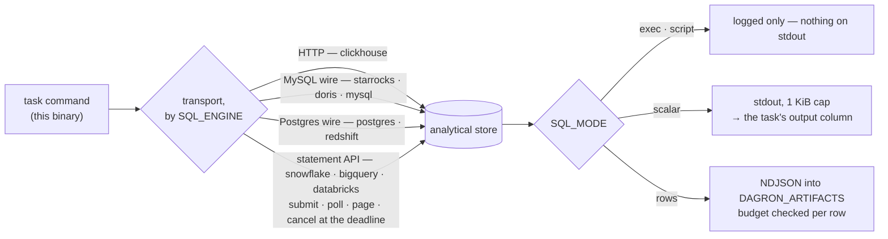

# dagron-step-sql — one statement against an analytical store, with a bounded result

One binary, one statement (or, in `script` mode, one script), per-protocol
transports. Named after what people search for (ClickHouse, StarRocks, Postgres,
Snowflake) and implemented against what actually varies (HTTP, MySQL wire, Postgres
wire, a vendor's statement API).

## Architecture



Rows never reach stdout, because the engine appends every stdout line to the task's
`output` column with no cap on that path. Which destination a mode uses *is* the
safety property.

## Quickstart

```yaml
- name: verify
  command: ["dagron-step-sql"]
  env:
    - { name: SQL_ENGINE,    value: clickhouse }
    - { name: SQL_DSN,       value: "http://reader@{{ env.CH_HOST }}:8123/" }
    - { name: SQL_PASSWORD,  value_from: { secret: CLICKHOUSE_PASSWORD } }
    - { name: SQL_MODE,      value: scalar }
    - { name: SQL_STATEMENT, value: "SELECT count() > 0 FROM marts WHERE ds = '{{ ds }}'" }
```

## Event flow

```mermaid
sequenceDiagram
  participant Engine as dagron engine
  participant Step as dagron-step-sql
  participant Store as analytical store

  Engine->>Step: dispatch (env: SQL_ENGINE, SQL_DSN, SQL_PASSWORD, …)
  Note over Step: refuse an inline credential in SQL_DSN<br/>(the redactor masks by NAME, and SQL_DSN is not one)
  Step->>Store: one statement, over the wire its engine speaks
  Store-->>Step: result rows, streamed — never the whole set at once
  loop per row, as it arrives
    Note over Step: Budget::admit — over budget means stop reading and write nothing
  end
  alt exec
    Step-->>Engine: nothing on stdout; outcome logged
  else scalar
    Step-->>Engine: one value on stdout, for a downstream when:
  else rows
    Step-->>Engine: NDJSON artifact; stdout stays empty
  end
```

## Why not `command: ["sh","-c","clickhouse-client …"]`

That already works, and the docs say so. Two things it cannot do:

1. **A bounded result contract** instead of `SELECT *` into an uncapped column.
2. One image instead of N vendor CLIs baked into N task images.

**What this step is not, yet.** Having a binary here leaves room for a cancel hook
(`KILL QUERY <query_id>`) and a defer handle, and **neither is built**. On the wire
and ClickHouse transports nothing captures a query id, so a cancelled run abandons
the statement exactly as an opaque `command:` would. The [statement
APIs](#statement-apis-snowflake-bigquery-databricks) do hold a handle, and cancel
their statement at the step's own deadline, but not when dagron cancels the run.
This step never prints `dagron::handle=`, so `defer:` on a `dagron-step-sql` task
would park on nothing — a 40-minute query holds its worker for 40 minutes.
[`dagron-step-spark`](../dagron-step-spark/) is the deferred one.

## The output contract is the point

Live-log streaming is unconditional in the engine, and each stdout line is appended
to the task's `output` column with `output = COALESCE(output,'') || ?` — **no cap
anywhere on that path**. So a `SELECT *` that writes rows to stdout is an unbounded
write into the datastore, and a check applied *after* the rows are printed is a check
applied after the damage.

Therefore: rows never go to stdout, and the budget is checked **before each row is
written**, so an over-budget statement writes nothing rather than being cleaned up
afterwards.

**It bounds the read too.** Both transports stream — `bytes_stream()` with
incremental NDJSON parsing on the HTTP path, `fetch` rather than `fetch_all` on the
wire path — so a row is admitted as it arrives and the first refusal drops the
stream. A `SELECT *` over a huge table fails with the message naming `SQL_MAX_ROWS`
or `SQL_MAX_BYTES` instead of being OOM-killed before the refusal can print;
resident memory is one row plus one chunk, whatever `SQL_MAX_BYTES` is set to. A
store that answers with one enormous row rather than many completes no row, so the
budget also refuses a row *while it is still arriving*.

The statement APIs answer a page at a time (a JSON document, not a stream of lines),
so there resident memory is **one page** rather than one row. Each page is refused
while it is still arriving once it passes twice `SQL_MAX_BYTES` plus 1 MiB for its
envelope, a size no page the budget would admit reaches. The next page is fetched
only when the rows before it have been admitted, so a refusal leaves the rest of
the result unfetched.

Streaming the read does not weaken the write: `rows` mode writes to a temporary file
and renames it into place only once the whole result has been admitted, so a refusal
still leaves nothing at the artifact path. A `LIMIT` in the statement remains the
better way to ask for less data — the store stops working, rather than this step
stopping reading — but it is no longer what stands between a careless `SELECT *` and
an exit code nobody can explain.

| `SQL_MODE` | What it writes |
|---|---|
| `exec` | **nothing to stdout** — the outcome is logged, and what the log carries differs by transport, so it is not something to gate on. For INSERT / MERGE / DDL |
| `scalar` | exactly one row, one column, to stdout — so a downstream `when:` can gate on it. **Both are enforced**: more than one row is refused rather than having its first taken, because without an `ORDER BY` there is no first row. Bounded by `MAX_SCALAR_BYTES` (1 KiB), **not** by `SQL_MAX_BYTES`: this is the one mode that writes to the uncapped `output` column on purpose, so it gets the stricter limit |
| `rows` | NDJSON into `$DAGRON_ARTIFACTS`. Never stdout |
| `script` | **nothing to stdout**, like `exec` — but for several statements run in order on one session. Not on ClickHouse; see [Scripts](#scripts) |

## Scripts

`exec` prepares its statement, and a prepared statement holds exactly one. Some
writes are a sequence — Postgres has no `CREATE OR REPLACE TABLE`, so recreating a
table is `BEGIN; DROP …; CREATE … AS …; COMMIT;` — and `script` mode exists for
them:

* **Sent as one simple-query message** (`sqlx::raw_sql`: no arguments, no
  preparation), which the store runs statement by statement on the same session.
  The first failure stops the script.
* **Atomicity is the script's**, not this step's. On Postgres a script with no
  `BEGIN`/`COMMIT` of its own runs as one implicit transaction; one that manages its
  own gets exactly what it wrote. The MySQL wire autocommits each statement, and DDL
  commits implicitly there.
* **Refused on ClickHouse.** ClickHouse's HTTP interface takes one statement per
  request, so a script there would run its first statement and silently drop the
  rest. The step fails before sending anything and says to split the script into
  tasks.
* **The statement APIs take a script their own way**, each still in one request:

  | Engine | How a script is sent | Atomic? |
  |---|---|---|
  | `snowflake` | `MULTI_STATEMENT_COUNT=0` on the request (the default, 1, is what holds `exec` to one statement) | only inside the script's own `BEGIN TRANSACTION … COMMIT` |
  | `bigquery` | as it is: BigQuery runs a multi-statement script wherever it is sent, so `exec` cannot hold it to one statement the way a prepared statement does | only inside the script's own `BEGIN TRANSACTION … COMMIT TRANSACTION` |
  | `databricks` | wrapped as one SQL-scripting compound statement, `BEGIN … END`, because the Statement Execution API takes one statement per request. Needs a warehouse on a release with SQL scripting | **no**: Delta has no multi-statement transactions, so a failure part-way leaves the statements before it applied |

Its main customer is a backfill planner that renders its own rebuild SQL. From plan
contract v4, [`dagron-state`](../dagron-state/#rendered-sql) expands `{{ sql }}` to
the planner's statements for each model it compiles into a task, and the env is the
place to put them — no shell quotes a multi-line script there. The `options` of the
envelope posted to `/api/state/plans/submit`:

```json
{
  "command_template": ["dagron-step-sql"],
  "env": {
    "SQL_ENGINE": "postgres",
    "SQL_DSN": "postgresql://etl@warehouse/analytics",
    "SQL_MODE": "script",
    "SQL_STATEMENT": "{{ sql }}"
  },
  "secret_env": { "SQL_PASSWORD": "WAREHOUSE_PASSWORD" }
}
```

`{{ sql }}` is dagron-state's placeholder, not a dagron template variable: each
generated task's `SQL_STATEMENT` holds that model's statements verbatim. The
password rides as `value_from: { secret: WAREHOUSE_PASSWORD }` on every task, so it
reaches this step the way the credential rules above require — resolved at dispatch,
masked by name, never in the plan.

A plan with a single statement per model can use `exec` instead; `{{ sql }}` passes a
lone statement through exactly as the planner rendered it, with no trailing `;`.

## Engines and transports

Maintenance here is bounded by **protocol count, not vendor count** — Airflow ran the
per-store-operator experiment and reversed it, deprecating `SnowflakeOperator`,
`BigQueryExecuteQueryOperator`, `PostgresOperator` and `TrinoOperator` in favour of
one `SQLExecuteQueryOperator` plus a connection. Per-store operators rot; generic SQL
plus a per-store connection ages.

| Transport | `SQL_ENGINE` values |
|---|---|
| HTTP | `clickhouse` |
| MySQL wire | `starrocks`, `doris`, `mysql` |
| Postgres wire | `postgres`, `redshift` (and anything speaking that wire — Materialize, CockroachDB, Greenplum) |
| Statement API | `snowflake` (SQL API v2), `bigquery` (`jobs.query`), `databricks` (Statement Execution API 2.0) |
| Child process | `duckdb` — the DuckDB CLI, as the engine that reads and writes Parquet for a store that cannot ([below](#duckdb)) |

The last row is three protocols, not one, and is counted against the bound that way.
None of the three answers on a wire another store shares, so no cheaper transport
exists for them. They share a *shape* (submit, poll a handle, page the result), so
one driver serves all three and each vendor is its request and answer formats.

## Statement APIs (Snowflake, BigQuery, Databricks)

These are the warehouses Freshet renders for that the wire transports cannot reach.
Each is driven over HTTPS through its own statement API:

1. **Submit** the statement with its session context, asking for an answer at once
   (Snowflake `async=true`) or within 5 s (BigQuery, Databricks).
2. **Poll** the handle it returns until the statement succeeds, fails or is
   cancelled: 250 ms, doubling to 5 s.
3. **Page** a settled result: Snowflake partitions, BigQuery page tokens, Databricks
   chunks.

**The DSN is the API's host, with the session as query parameters.** No path and no
user: the token alone says who is asking. A parameter the step does not know is
refused, not dropped, because a misspelt `warehouse_Id` that is ignored runs the
statement somewhere you did not ask for. Plain `http://` is refused except to
loopback, because every request carries the token.

| `SQL_ENGINE` | `SQL_DSN` | Parameters |
|---|---|---|
| `snowflake` | `https://<account>.snowflakecomputing.com/?warehouse=TRANSFORM&database=ANALYTICS&schema=PUBLIC&role=TRANSFORMER` | `warehouse`, `database`, `schema`, `role`, all optional (the user's defaults otherwise) |
| `bigquery` | `https://bigquery.googleapis.com/?project=my-project&dataset=analytics&location=EU` | `project` **required**; `dataset` (the default dataset for unqualified names), `location` |
| `databricks` | `https://<workspace>.cloud.databricks.com/?warehouse_id=abc123&catalog=main&schema=analytics` | `warehouse_id` **required**; `catalog`, `schema` |

**The credential is a bearer token in `SQL_PASSWORD`**, masked by name like every
other credential this step takes:

| `SQL_ENGINE` | Token |
|---|---|
| `snowflake` | a programmatic access token by default. `SQL_TOKEN_TYPE=oauth` or `keypair_jwt` for the other two kinds Snowflake takes. Those two live minutes to an hour, so they are minted just before the run; this step mints neither |
| `bigquery` | an OAuth access token, **or none**: with `SQL_PASSWORD` unset the step asks the GCE metadata server for its service account's token (GKE Workload Identity, Compute Engine, Cloud Run), fetching it again before it expires. `GCE_METADATA_HOST` moves the server, as it does for Google's own libraries. A service-account key file is not read |
| `databricks` | a personal access token, or an OAuth token for a service principal. The OAuth client-credentials exchange itself is not built |

**The deadline cancels.** `SQL_TIMEOUT_SECS` (default 300) covers every call: submit,
polls and pages. A statement still running when it passes is **cancelled** through
its API, and so is one whose polls stop being answered. Without the cancel, the
warehouse would go on spending on a statement nobody is waiting for. Snowflake is
also sent the deadline as its own statement `timeout`, which holds even when the step
is killed outright. A poll or a page that fails in transit (no connection, `429`,
`5xx`) is retried up to three times. A submit is never retried, because a submit
whose answer was lost may have started the statement.

**The budget reaches the store where the API lets it.** `scalar` asks for two rows,
and `rows` for one past `SQL_MAX_ROWS`, through BigQuery's `maxResults` and
Databricks' `row_limit`. It is one past, so a result over the budget is refused
rather than trimmed to fit. `exec` and `script` ask BigQuery for no rows at all,
and on Snowflake a finished `exec` is settled by its status without its result
being read. Snowflake's API has no row limit, so there the budget bounds the read
alone, as on the wire transports.

**Values are the API's text.** Each row is one JSON object keyed by column name, as
on the other transports. The values are strings and nulls, because all three APIs
render every value as text. Nothing is re-typed: a `NUMBER(38,0)` does not fit an
`i64`, and losing its digits silently is worse than handing over the text. BigQuery
records become objects and its repeated fields arrays, and its timestamps are
integer microseconds (`useInt64Timestamp`). A scalar prints the text as the API sent
it, so write a `when:` against that text, and cast in the statement
(`SELECT IFF(count(*) > 0, 1, 0)`) when the gate wants a number.

**Not built:** cancelling when dagron cancels the run (the statement then runs out
its own timeout, which only Snowflake is given); results beyond an API's inline
JSON (Databricks' 25 MiB `INLINE` limit, Arrow and external links); minting a
Snowflake key-pair JWT, a Google token from a key file, or a Databricks OAuth token.

**Verified against stand-ins, not yet against the services.**
`tests/statement_api.rs` drives the built binary against local stand-ins that answer
in each API's documented shapes. A run against each service is what proves it still
answers in them.

```yaml
- name: rollup
  command: ["dagron-step-sql"]
  env:
    - { name: SQL_ENGINE,    value: snowflake }
    - { name: SQL_DSN,       value: "https://acme-prod.snowflakecomputing.com/?warehouse=TRANSFORM&database=ANALYTICS&schema=MARTS" }
    - { name: SQL_PASSWORD,  value_from: { secret: SNOWFLAKE_PAT } }
    - { name: SQL_MODE,      value: exec }
    - { name: SQL_STATEMENT, value: "INSERT OVERWRITE INTO daily SELECT … FROM events WHERE ds = '{{ ds }}'" }
```

## DuckDB

`SQL_ENGINE=duckdb` is not a store. It is the engine a copy uses where a store cannot
read or write Parquet itself, above all Postgres on-prem, which DuckDB attaches with
its `postgres` extension. So it runs `exec` and `script`, and refuses `rows` and
`scalar` before starting anything.

* **The DuckDB CLI**, `duckdb` on `PATH` or wherever `SQL_DUCKDB` says, run as
  `duckdb -bail <SQL_DSN>`. `SQL_DSN` is the database: `:memory:` for a copy. The
  library is not linked: that would compile DuckDB's C++ into every build of this
  step, for an engine most of its tasks never touch.
* **The script goes on stdin**, never in argv, where a process listing shows it.
  `-bail` stops at the first failing statement, and closing the process rolls back
  whatever transaction the script had open, in DuckDB and in a Postgres it attached.
* **stdout is read and dropped.** The CLI prints a table for each statement with a
  result, and `exec`/`script` put nothing on the task's output. stderr is kept (8 KiB)
  for the error.
* **The attached Postgres is reached through libpq's environment**: `PGHOST`,
  `PGPORT`, `PGDATABASE`, `PGUSER` on the task, and `SQL_PASSWORD`, which the step
  hands the CLI as `PGPASSWORD`. A script that writes `ATTACH '' AS pg (TYPE postgres)`
  names no host and holds no secret, which is how Freshet renders one.
* **`SQL_TIMEOUT_SECS` kills it**, which ends the statement and rolls it back.
* **Extensions**: `INSTALL postgres` fetches it on first use. An image that cannot
  reach the network bakes the extensions it needs in.

**Tested against a stand-in CLI** (`tests/duckdb.rs`), which pins stdin, the exit
status, stderr, stdout kept off the task's output, and the deadline. What DuckDB does
with Freshet's SQL is shown by the move rehearsal, against a real DuckDB and Postgres.

## Parity: `dagron-step-sql parity`

The other command this binary answers: **is one relation's partition the same on two
stores?** It is the check a warehouse move is cut over on, every partition shown equal,
and it is how a side-by-side period is checked between rebuilds.

```yaml
- name: parity_events_2026_06_20
  command: ["dagron-step-sql", "parity"]
  env:
    - { name: PARITY_SOURCE_ENGINE,   value: postgres }
    - { name: PARITY_SOURCE_DSN,      value: "postgresql://reader@old-warehouse/analytics" }
    - { name: PARITY_SOURCE_PASSWORD, value_from: { secret: OLD_WAREHOUSE_PASSWORD } }
    - { name: PARITY_SOURCE_SCHEMA,   value: public }
    - { name: PARITY_SOURCE_TABLE,    value: events }
    - { name: PARITY_SOURCE_WHERE,    value: "dt IN (DATE '2026-06-20')" }
    - { name: PARITY_TARGET_ENGINE,   value: snowflake }
    - { name: PARITY_TARGET_DSN,      value: "https://acme.snowflakecomputing.com/?warehouse=CHECK&database=ANALYTICS" }
    - { name: PARITY_TARGET_PASSWORD, value_from: { secret: SNOWFLAKE_PAT } }
    - { name: PARITY_TARGET_SCHEMA,   value: MARTS }
    - { name: PARITY_TARGET_TABLE,    value: events }
    - { name: PARITY_TARGET_WHERE,    value: "dt IN (DATE '2026-06-20')" }
```

Each side is read under its own prefix with the variables the step reads under `SQL_`
(`ENGINE`, `DSN`, `PASSWORD`, `USER`, `TOKEN_TYPE`, `TIMEOUT_SECS`), and runs through the
same transports, so every credential and budget rule above holds. Then what to compare:
`…_TABLE` (required), `…_SCHEMA` (`schema`, or `db.schema` / `catalog.schema` /
`project.dataset`; BigQuery needs it), `…_RELATION` (the relation as that side's SQL
writes it; composed from the two when unset) and `…_WHERE` (the rows, in that side's
dialect; unset compares the whole relation). `freshet move` renders all of them.

**Two numbers per side, computed where the data is**, so nothing else crosses the
network: the **row count**, which catches a dropped or a duplicated row, and an
**order-independent checksum**, the sum over the rows of 60 bits of the MD5 of each
row's canonical text, which catches a changed value. A sum ignores row order, and
unlike an XOR it counts a duplicate twice.

**Canonical text is what makes two stores comparable.** Postgres prints `1.50` and
BigQuery `1.5`, and no two warehouses spell a timestamp alike. So each side's columns
are read from its `information_schema`, put in a family, and rendered in a form every
store prints the same way:

| Family | Compared as |
|---|---|
| integers, decimals | the value × 10^scale as an integer, at the larger of the two scales (at most 18 places) |
| floats (and a `numeric` with no declared scale) | the same, rounded to `PARITY_FLOAT_DIGITS` places (default 6) |
| boolean | `1` / `0` |
| date | days since 1970-01-01 |
| timestamp | microseconds since 1970-01-01 UTC; one with no zone is read as UTC |
| text | itself |

Each cell is `length:text`, or `N` for NULL, so values cannot run together and NULL is
not the empty string. Columns pair by name, ignoring case, and are hashed in name order,
so a target created with its columns in another order still compares.

**Strict where it matters.** A column only one side has, or one whose families cannot
be compared (a date against text), is a difference. A type outside the families (JSON,
arrays, structs, binary, time of day) is refused rather than cast to text and hoped
for. Not exact by design: floats at `PARITY_FLOAT_DIGITS` places, and stores round an
exact tie at the last place differently.

| Exit | Verdict |
|---|---|
| `0` | **shown equal**: one line on stdout, `equal: <n> row(s), checksum <c>` |
| `2` | **shown different**: row counts, checksums or columns differ; stderr says which |
| `1` | **not compared**: a side could not be read, or holds a type it will not compare |

With `$DAGRON_ARTIFACTS` set, `parity.json` records both sides' numbers, every column
and how it was compared, whatever the verdict.

**Executed against Postgres** (`tests/parity.rs`: a faithful copy equal; a dropped, a
duplicated and a changed row caught; NULL against the empty string; reordered and
widened columns; a missing column; a refused type). CI runs it against the Postgres
`scripts/ci-test.sh` starts. Redshift, Snowflake, BigQuery and Databricks get the same
canonical forms in their own SQL, pinned by unit tests and written from each vendor's
documented functions, and not yet run against those services.

## Configuration

| Variable | Meaning |
|---|---|
| `SQL_ENGINE` | which store (table above) — **required** |
| `SQL_DSN` | how to reach it — **required** |
| `SQL_STATEMENT` / `SQL_STATEMENT_FILE` | the one statement to run — in `script` mode, the script |
| `SQL_MODE` | `exec` · `scalar` · `rows` · `script` |
| `SQL_USER` | username, when the DSN does not carry one. Not used by the statement APIs, which authenticate by token alone |
| `SQL_PASSWORD` | the credential — for the statement APIs, the bearer token. **Always pass via `value_from: { secret: … }`** |
| `SQL_TOKEN_TYPE` | Snowflake only: `programmatic_access_token` (default), `oauth` or `keypair_jwt` |
| `GCE_METADATA_HOST` | BigQuery only, with no `SQL_PASSWORD`: where the metadata server is (default `metadata.google.internal`) |
| `SQL_MAX_ROWS` | row budget, refused before anything is written (default `10000`) |
| `SQL_MAX_BYTES` | byte budget, same (default `8 MiB`) |
| `SQL_TIMEOUT_SECS` | statement deadline (default `300`). On the statement APIs it covers every call, and a statement still running at it is cancelled |
| `SQL_OUTPUT_NAME` | artifact filename in `rows` mode (default `result.ndjson`) |
| `SQL_DUCKDB` | DuckDB only: the CLI to run (default `duckdb` on `PATH`) |
| `PARITY_SOURCE_…`, `PARITY_TARGET_…`, `PARITY_FLOAT_DIGITS` | `parity` only: [see above](#parity-dagron-step-sql-parity) |

**A credential inline in the DSN is refused, not warned about.** The engine's
redactor masks task env vars by *name*, so a password inside `SQL_DSN` would be
logged in full — the refusal points at `SQL_PASSWORD`, which is masked.

## Features

`mysql` and `postgres` are **not** default features (each also enables `sqlx/any`).
The default build carries the HTTP transports only (ClickHouse and the three
statement APIs, which need no driver beyond the HTTP client); the published image is
built with both. CI lints and tests both worlds.

## Image

`mancube/dagron-step-sql` — a Rust binary on distroless/cc, nonroot (uid 65532),
`linux/amd64` + `linux/arm64`. Usually you copy the binary into the image your task
already uses:

```dockerfile
COPY --from=mancube/dagron-step-sql:0.10 \
     /usr/local/bin/dagron-step-sql /usr/local/bin/dagron-step-sql
```

The image does not carry the DuckDB CLI. A copy task that unloads or loads Postgres
through `SQL_ENGINE=duckdb` uses an image with both binaries (and the `postgres`
extension installed, if it cannot reach the network).

## See also

- [`examples/warehouse/`](../../examples/warehouse/) — this step gating a publish on a partition check
- [`dagron-step-spark`](../dagron-step-spark/) — the other half of the warehouse pair
- [`docs/EXTERNAL_JOBS.md`](../../docs/EXTERNAL_JOBS.md) — `defer:` and the park shape
