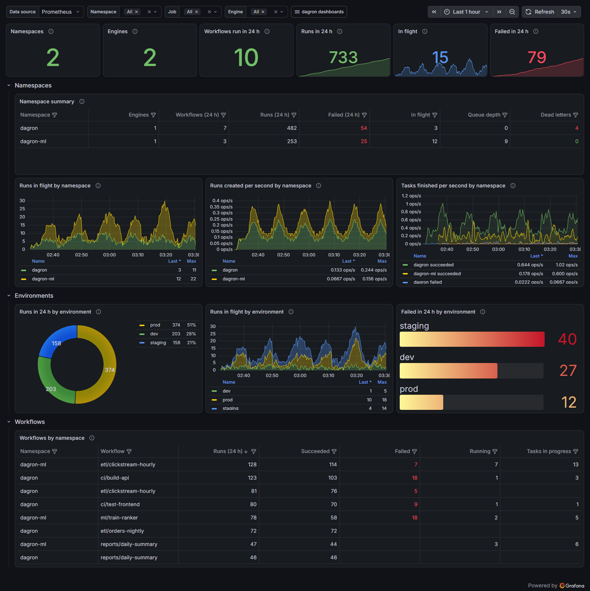
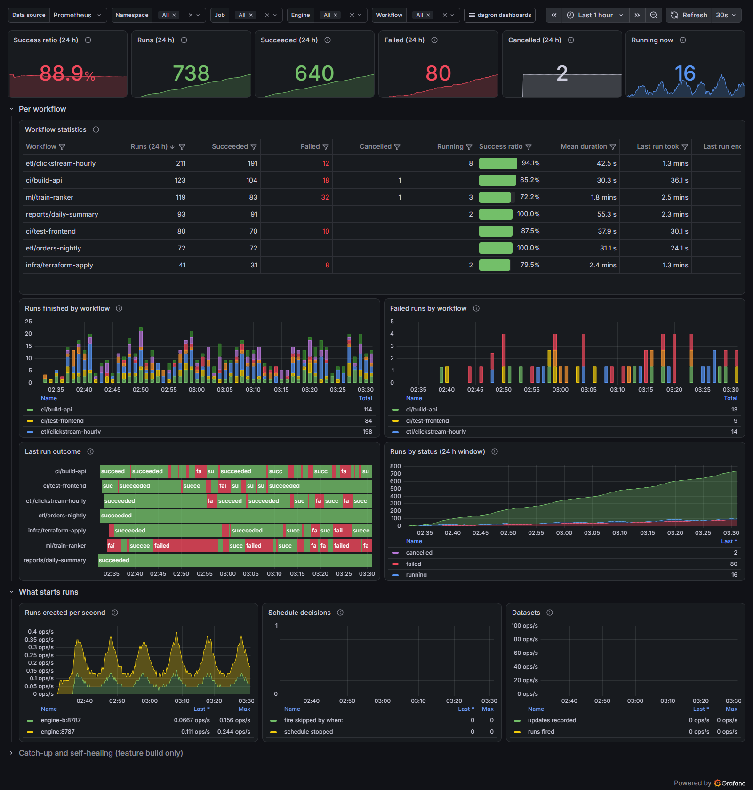
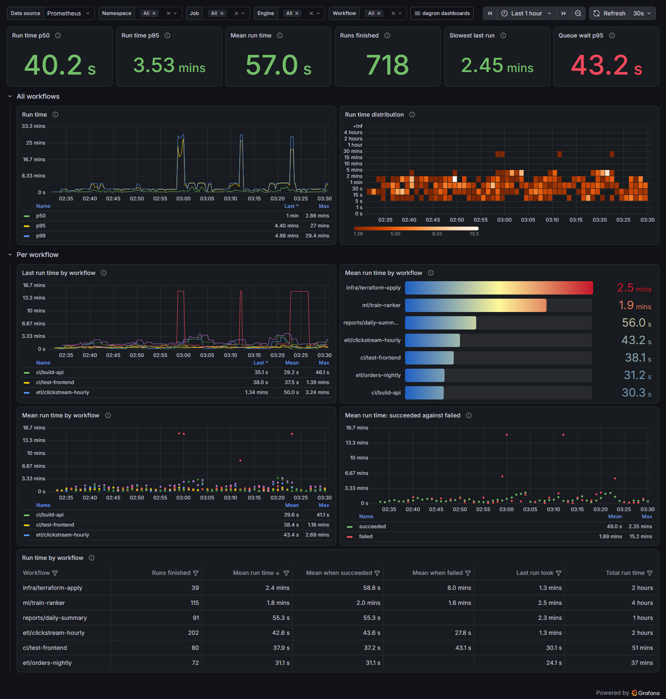
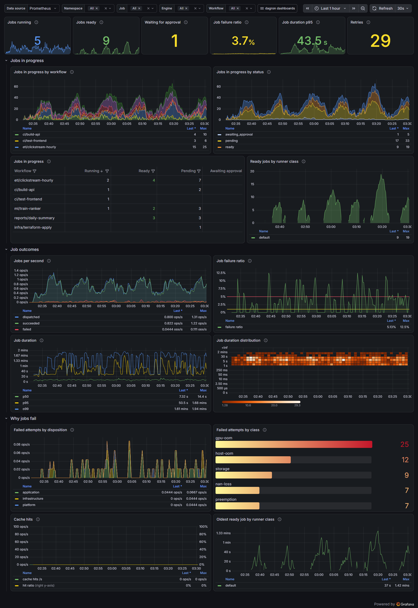
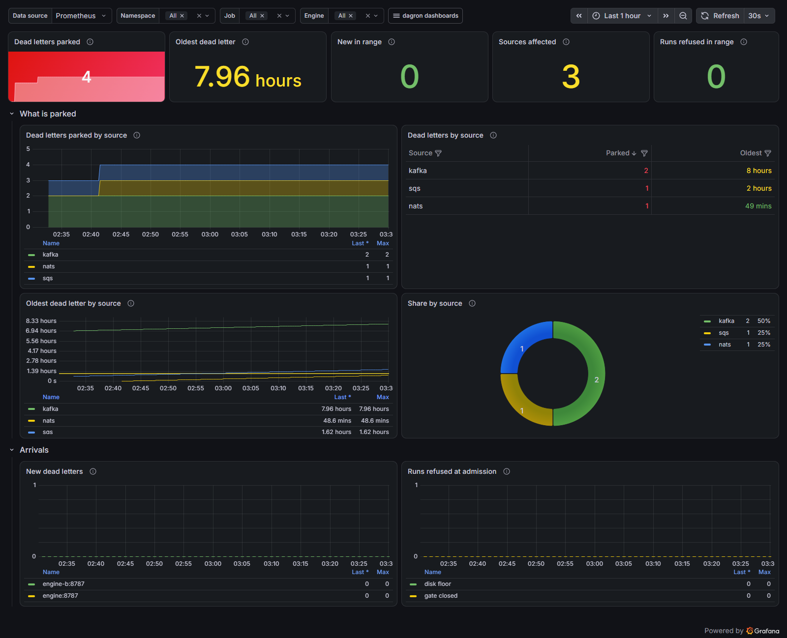
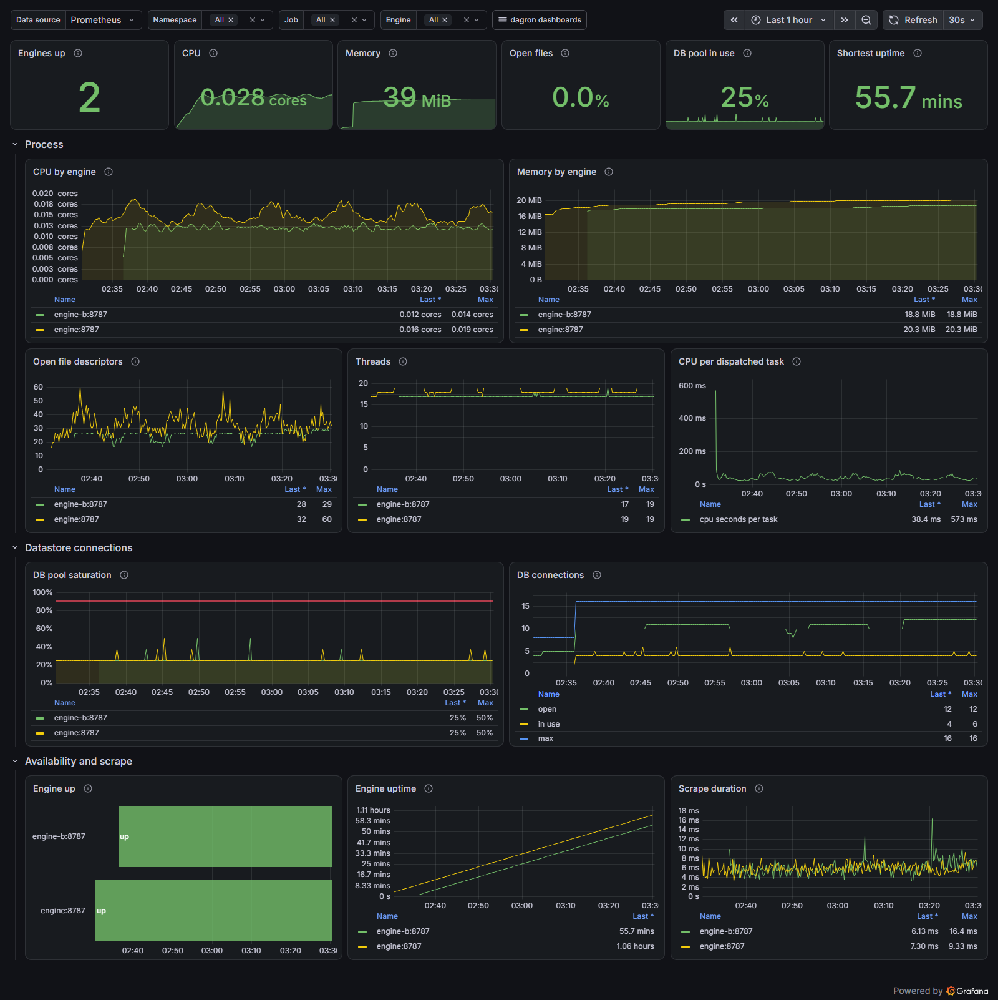
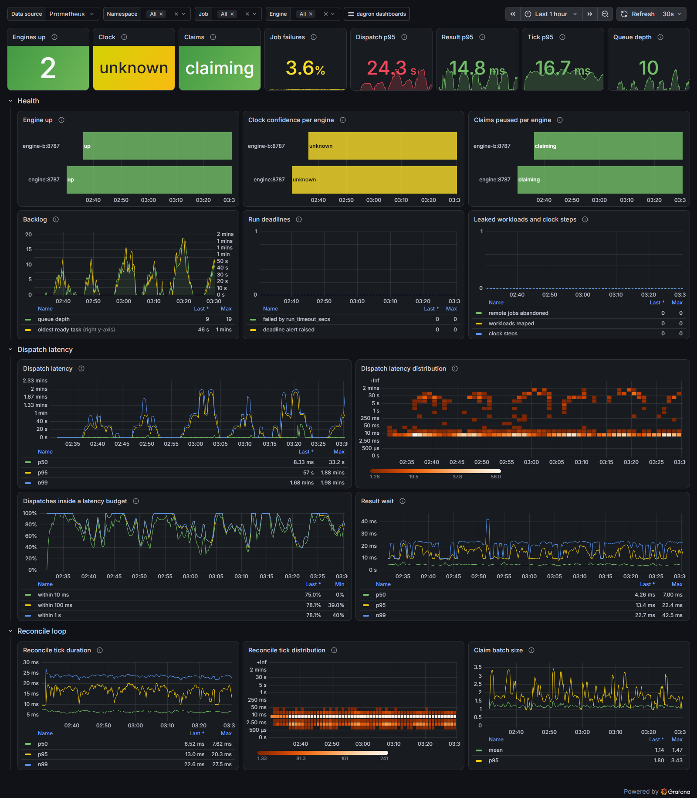

# dagron metrics guide

Every metric the dagron engine exports, what it measures, how to query it, what
to alert on, and the Grafana dashboards that are built from it.

- [Where the metrics come from](#where-the-metrics-come-from)
- [Reading them correctly](#reading-them-correctly)
- [Metric reference](#metric-reference)
- [Query recipes](#query-recipes)
- [Alerts](#alerts)
- [Dashboards](#dashboards)
- [What the metrics do not tell you](#what-the-metrics-do-not-tell-you)

## Where the metrics come from

The **engine** serves Prometheus text at `GET /metrics` on its management API
(`text/plain; version=0.0.4`). Two things must be true:

1. the engine is an `ops` build (the default, and what every published image is);
2. `API_ADDR` is set, for example `API_ADDR=0.0.0.0:8787`.

The endpoint has no authentication, like the rest of the management API. The
network is its boundary: in the Helm chart, `networkPolicy.engine.monitoringNamespace`
names the one namespace allowed to scrape it.

`dagron-api` (the gateway) does not serve Prometheus text. Its `GET /api/metrics`
is JSON for the console, cached in two tiers as the engine's gauges are: what
has not finished for `DAGRON_METRICS_CACHE_SECS` (2 s), the finished statuses
for `DAGRON_METRICS_HISTORY_CACHE_SECS` (300 s). Point Prometheus at the
engine.

A minimal scrape config:

```yaml
scrape_configs:
  - job_name: dagron-engine
    metrics_path: /metrics
    static_configs:
      - targets: ["engine:8787"]
        labels:
          namespace: dagron   # see "The namespace label" below
```

On Kubernetes with the Prometheus Operator, use a `ServiceMonitor` on the engine
Service; [`loadtest/deploy/dagron/servicemonitor.yaml`](../loadtest/deploy/dagron/servicemonitor.yaml)
is a working one. A ready-to-run local stack is in
[`examples/monitoring/`](../examples/monitoring/).

## Reading them correctly

The series fall into three kinds, and each is aggregated differently. Getting
this wrong is the most common way to draw a wrong graph.

| Kind | What it is | Across engines | Examples |
|---|---|---|---|
| **Process counters and histograms** | Counted by one engine since it started. Reset to zero on restart. | `sum(rate(...))` or `sum(increase(...))` | `scheduler_tasks_succeeded_total`, `scheduler_dispatch_latency_seconds` |
| **Datastore gauges** | Read from the database and cached by each engine in two tiers: what has not finished for `METRICS_CACHE_SECS` (default 10 s, `0` = every scrape, and then the history too where `METRICS_HISTORY_CACHE_SECS` is not set), and the history (the counts of the finished statuses, and the finished runs of the last 24 hours) for `METRICS_HISTORY_CACHE_SECS` (default 300 s; see [docs/CONFIG.md](CONFIG.md)). A read that does not return is given up, after 30 s for what has not finished and after the history's TTL or 60 s, whichever is longer, for the history, and a scrape that waited for it answers `500`. Every engine of one installation reports the same number, give or take that lag. | `max(...)`, never `sum(...)` | `scheduler_runs`, `scheduler_queue_depth`, `scheduler_workflow_recent_runs` |
| **Engine state gauges** | The current state of one engine. | per `instance`, or `max` for "is any engine affected" | `scheduler_claims_paused`, `scheduler_db_pool_in_use`, `process_resident_memory_bytes` |

With three engines on one Postgres, `sum(scheduler_queue_depth)` is three times
the real backlog. `max(scheduler_queue_depth)` is right.

### Labels

Labels dagron sets itself:

| Label | On | Values |
|---|---|---|
| `status` | run and task gauges, per-workflow series | runs: `pending`, `running`, `succeeded`, `failed`, `cancelled`. Tasks add `ready`, `awaiting_approval`, `skipped`. |
| `workflow` | per-workflow series | the workflow's `name:` |
| `environment` | `scheduler_environment_recent_runs` | the run's `environment:`, or `(none)` |
| `runner_class` | ready-backlog gauges | the task's `runner_class:` (`default` when unset) |
| `class`, `disposition` | fault counters | see [Faults](#faults) |
| `source` | dead-letter gauges | the ingest source that produced the row |
| `le` | histograms | bucket upper bound |

Every label that takes its value from a submitted workflow is capped, so one
client cannot create an unbounded number of series:

| Label | Series kept | The rest |
|---|---|---|
| `workflow` | 50 busiest | summed as `workflow="other"` |
| `environment`, `source`, `runner_class` | 20 busiest | summed as `"other"` |

For the age gauges the `other` series carries the oldest age in the tail, so
something folded into it can still fire an alert.

### The namespace label

dagron has no namespace of its own. `namespace` is a label Prometheus puts on
the scrape target: on Kubernetes a `ServiceMonitor` sets it to the engine pod's
namespace, and elsewhere you set it in the scrape config as shown above. The
dashboards group and filter by it, which is how one Grafana shows several
installations side by side. If the label is absent the dashboards still work,
with one unnamed group.

Inside one installation, the grouping dagron does have is the named
`environment:` a run declares.

## Metric reference

All names start with `scheduler_` except the process metrics, which use the
standard `process_` names.

### Runs and workflows

| Metric | Type | Labels | Meaning |
|---|---|---|---|
| `scheduler_runs_created_total` | counter | | Runs this engine created, whatever started them: the API, a schedule, a dataset trigger, a backfill, an ingest source. |
| `scheduler_runs` | gauge (datastore) | `status` | Every run in the datastore, by status. Terminal counts fall when retention removes old runs. `pending` and `running` are read for a scrape; the finished statuses with the history, every `METRICS_HISTORY_CACHE_SECS` (300 s), behind the scrape that finds it stale, so they can be that far behind, plus the time until that scrape and the read it starts, and further while reads of it fail; a sum over every status moves at each refresh of them. |
| `scheduler_workflow_recent_runs` | gauge (datastore) | `workflow`, `status` | Runs created in the last 24 hours, by workflow and current status. `pending` and `running` are read for a scrape; the finished statuses with the history, every `METRICS_HISTORY_CACHE_SECS`. |
| `scheduler_environment_recent_runs` | gauge (datastore) | `environment`, `status` | The same runs, by environment. |
| `scheduler_run_duration_seconds` | histogram | `le` | Wall time from a run being created to reaching a terminal state: queueing, every task, and any wait at an approval gate. Buckets from 1 s to 4 h. |
| `scheduler_workflow_run_duration_seconds` | summary (`_sum`, `_count`) | `workflow`, `status` | The same wall time, totalled by workflow and outcome (`succeeded`, `failed`). No quantiles: the sum and the count give a mean and a success ratio. |
| `scheduler_workflow_last_run_duration_seconds` | gauge | `workflow` | Wall time of the workflow's most recently finished run. |
| `scheduler_workflow_last_run_finished_timestamp_seconds` | gauge | `workflow` | Unix time that run finished. |
| `scheduler_workflow_last_run_success` | gauge | `workflow` | `1` if that run succeeded, `0` if it failed. |
| `scheduler_runs_deadline_exceeded_total` | counter | | Runs failed by `run_timeout_secs`. |
| `scheduler_runs_admitted_total` | counter | | Runs this scheduler let in after they waited for their workflow's `max_active_runs` (`when_full`). |
| `scheduler_image_pulls_total` | counter | | Pulls of a task's, a service's or a step's image the Docker executor made (each of the engine's own two images too). One image is pulled once at a time on a host however many tasks want it. |
| `scheduler_image_pull_failures_total` | counter | | Those pulls that failed. |
| `scheduler_image_cache_hits_total` | counter | | Images a task was given without a pull: held on the host already, or pinned to a digest for its run. |
| `scheduler_runs_waiting` | gauge (datastore) | | Runs made while their workflow's `max_active_runs` was full, which wait for a turn and have started nothing. |
| `scheduler_runs_waiting_oldest_age_seconds` | gauge (datastore) | | Seconds the run that has waited longest has waited. `0` when none waits. |
| `scheduler_deadline_alerts_total` | counter | | Soft SLA alerts raised by `deadline:`. The run keeps running. |

The run-duration series (histogram, summary and the three `last_run` gauges)
count runs the reconcile loop finalized as succeeded or failed, plus runs failed
by `run_timeout_secs`. Cancelled runs are not in them.

### Tasks (jobs)

| Metric | Type | Labels | Meaning |
|---|---|---|---|
| `scheduler_tasks_dispatched_total` | counter | | Task attempts handed to a worker. |
| `scheduler_tasks_succeeded_total` | counter | | Tasks that finished successfully. |
| `scheduler_tasks_failed_total` | counter | | Tasks that failed for good: retries exhausted, or a timeout that opted out of retry. |
| `scheduler_tasks_retried_total` | counter | | Failed attempts rescheduled for another try. |
| `scheduler_cache_hits_total` | counter | | Tasks answered from the memoization cache without running. |
| `scheduler_tasks` | gauge (datastore) | `status` | Every task in the datastore, by status. `pending`, `ready`, `running` and `awaiting_approval` are read for a scrape; the finished statuses with the history, every `METRICS_HISTORY_CACHE_SECS`. |
| `scheduler_workflow_active_tasks` | gauge (datastore) | `workflow`, `status` | Tasks that have not finished, by workflow. Status is `pending` (waiting on dependencies), `ready`, `running` or `awaiting_approval`. |
| `scheduler_task_duration_seconds` | histogram | `le` | Task wall time from claim to finish, measured in the worker. |

Cancelled tasks are in neither `succeeded` nor `failed`.

`scheduler_tasks_dispatched_total` also counts a dispatch that Kubernetes
refused for a full namespace quota. When the task waits, that dispatch used no
attempt: it is in none of the other counters here, and has
[counters of its own](#waiting-on-namespace-quota). When the task does not wait
(`DAGRON_QUOTA_WAIT_MAX_SECS=0`, or a `gang:` member under `RUNNER_GANGS`), the
refusal is a failed attempt and is counted in `scheduler_tasks_retried_total`
or `scheduler_tasks_failed_total`. Either way it records no sample in
`scheduler_task_duration_seconds`: nothing ran.

### Backlog

| Metric | Type | Labels | Meaning |
|---|---|---|---|
| `scheduler_queue_depth` | gauge (datastore) | | Ready tasks waiting for a worker. |
| `scheduler_ready_tasks_by_class` | gauge (datastore) | `runner_class` | The same backlog, by the pool that must serve it. |
| `scheduler_ready_oldest_age_seconds` | gauge (datastore) | `runner_class` | Age of the longest-waiting ready task in the class. A class no engine serves only ever grows here. |

The two per-class gauges are emitted only while there is at least one ready
task. In an alert, an absent series means an empty queue, not a broken scrape.

A task waiting on a namespace quota is a ready task, so all three include it.
`scheduler_ready_oldest_age_seconds` does not show how long it has waited:
every refusal moves the task's due time forward, and the age is counted from
there. `scheduler_quota_wait_oldest_age_seconds`, below, is the one that does.

### Waiting on namespace quota

On the Kubernetes executor, a pod the apiserver refuses because the namespace
is at its `ResourceQuota` is not a failed attempt. The task goes back to
`ready`, keeps its attempt, and is dispatched again later, for up to
`DAGRON_QUOTA_WAIT_MAX_SECS` ([`CONFIG.md`](CONFIG.md)).

A dispatch held back because an earlier attempt of its task is still stopping
goes the same way, on Docker and on Kubernetes, and is counted and shown with
these. Its refusal text says which it is: "an earlier attempt of this task may
still be running". Such a wait lasts a task's grace, not a queue's length.

| Metric | Type | Labels | Meaning |
|---|---|---|---|
| `scheduler_quota_refusals_total` | counter | | Dispatches refused by a full namespace quota and returned to the queue. No attempt was consumed. |
| `scheduler_quota_wait_expired_total` | counter | | Tasks failed because they waited on quota past `DAGRON_QUOTA_WAIT_MAX_SECS`. |
| `scheduler_tasks_waiting_on_quota` | gauge (datastore) | | Ready tasks whose last dispatch was refused for quota. |
| `scheduler_quota_wait_oldest_age_seconds` | gauge (datastore) | | Seconds since the first refusal of the task that has waited longest. `0` when none is waiting. |

All four are emitted at zero from the first scrape, whatever the executor.

A refusal the task waits on is not a retry, a failure or a fault:
`scheduler_tasks_retried_total`, `scheduler_tasks_failed_total` and the fault
counters do not move while a task waits. A task that waits past the bound is
counted once in `scheduler_tasks_failed_total` and once in
`scheduler_quota_wait_expired_total`. Its failure has no fault class.

A refusal the task does not wait on (`DAGRON_QUOTA_WAIT_MAX_SECS=0`, or a
`gang:` member under `RUNNER_GANGS`) is in none of these four. It is a failed
attempt, counted in `scheduler_tasks_retried_total` when the task has attempts
left and in `scheduler_tasks_failed_total` when it has not.

### Scheduler latency

All but `scheduler_image_pull_seconds` are histograms with the same buckets: 250 µs to 300 s. That one's are the run histogram's, 1 s to 4 h: a pull can take minutes.

| Metric | Meaning |
|---|---|
| `scheduler_image_pull_seconds` | How long a pull of an image took on the Docker executor, to its end or its failure. Buckets 1 s to 4 h. |
| `scheduler_dispatch_latency_seconds` | A task becoming claimable to being handed to a worker: claim wait, tick pacing, dispatch preparation. A retry's clock starts at its due time, so backoff is not counted. This is the scheduler's own queueing delay. |
| `scheduler_result_wait_seconds` | The executor finishing to the reconcile loop collecting the result. |
| `scheduler_reconcile_tick_seconds` | One pass of the reconcile loop: recover, advance, dispatch, collect, reap. |
| `scheduler_claim_batch_size` | Tasks taken by one non-empty claim call. The unit is tasks, not seconds; buckets 1 to 256. |

One counter reads beside `scheduler_reconcile_tick_seconds`:

| Metric | Type | Meaning |
|---|---|---|
| `scheduler_notifications_total` | counter | Datastore notifications the reconcile loop took. On Postgres every engine is notified of each change that can make work ready, and of each append to a task's log (`LISTEN/NOTIFY`); on SQLite there are none, and this stays 0. |
| `scheduler_runs_reaped_by_sweep_total` | counter | Runs the slow sweep of running runs found ended (`REAP_INTERVAL_MS`) before the loop had taken a notification that named them. A run whose own notification was still on its way is counted now and then. On Postgres a task's end notifies its run, whoever ends it, by a trigger on `task_runs` (`migrations_pg/107`), so one that rises steadily says notifications are being lost, or that runs end by a change that is not a task's end: those runs end some sweep intervals after their last task. Before 107 the skips after a failure, a fan-out's barrier, the time, HTTP and dataset sensors, an external job's end and a sub-workflow's trigger notified nobody, and each such run was counted here. On SQLite, where the file's triggers write a run's wake (`run_wakes`) and the loop takes it, it counts the runs that ended with no wake written, a change the triggers do not see: the case to alert on, as a steady rise is on Postgres. Now and then it also counts a run whose wake was written between a tick's take and its slice, by dagron-api or another process on the file, as Postgres counts a notification still on its way. |

The loop takes every notification that is waiting and runs one pass for them
all, since a pass looks at everything whichever notification woke it. So
`rate(scheduler_notifications_total[5m]) / rate(scheduler_reconcile_tick_seconds_count[5m])`
is how many notifications a pass answered. Well above 1, notifications are
arriving faster than the loop runs, and are being taken together. A pass is
also run on the poll timer and when a task finishes on this engine, so a
quiet engine reads under 1.

### Sweeps

The reconcile loop's maintenance sweeps, each by name in the `sweep` label:
`orphans`, `leases`, `sessions`, `stops`, `quota_summary`, `deadlines`,
`stopped_runs`, `admissions`, `alerts`, `approvals`, `subworkflows`, `fanouts`,
`waits`, `url_waits`,
`external_polls`, `external_cancels`, `dataset_waits`, `dataset_triggers`,
`teardowns`, `gangs` and `reap`. Each runs at its own interval
(`SWEEP_INTERVALS`, [docs/CONFIG.md](CONFIG.md)), and those of the
installation are run by one engine a window (`SWEEP_SHARE`): the engine that
takes the sweep's slot. Every sweep is emitted from the first scrape, at zero.

| Metric | Type | Labels | Meaning |
|---|---|---|---|
| `scheduler_sweep_passes_total` | counter | `sweep`, `outcome` | Windows of each sweep this engine saw due: `ran`, it ran the sweep; `elsewhere`, another engine had taken its slot. An engine's own sweeps are never `elsewhere`. |
| `scheduler_sweep_seconds_total` | counter | `sweep` | Time this engine's passes of each sweep took. |
| `scheduler_sweep_rows_total` | counter | `sweep` | Rows this engine's passes acted on: leases recovered, runs failed, sensors resolved, barriers expanded or joined, workloads deleted. |
| `scheduler_sweep_last_pass_timestamp_seconds` | gauge | `sweep` | Unix time each sweep last ran on this engine, whether or not it found anything to do (the stops of an engine that holds no task, the teardowns of one with no room for any, and the reap a tick that looked at every running run did in full, all count); `0` for never. |
| `scheduler_sweep_interval_seconds` | gauge | `sweep` | Each sweep's interval on this engine; `0` for a sweep switched off here (`orphans` with no `DAGRON_INSTALLATION`, `gangs` without gangs, `quota_summary` with `DAGRON_QUOTA_WAIT_MAX_SECS=0`, `dataset_triggers` with `DATASET_TRIGGERS=0`), and for `reap` with `REAP_INTERVAL_MS=0`. |
| `scheduler_sweep_lateness_seconds` | histogram | `sweep`, `le` | How long after it fell due a sweep acted on what it did: a time sensor's `wake_at`, an HTTP sensor's next poll, a run's deadline or soft deadline, an approval's timeout. Buckets 0.05 s to 300 s. For `waits`, `url_waits`, `deadlines`, `alerts` and `approvals` alone. |
| `scheduler_db_invalid_indexes` | gauge | | Indexes of the datastore that a `CREATE INDEX CONCURRENTLY` cut short left INVALID, as the engine last looked (not those of a table an index is being built on as it looks, which are INVALID until the build ends; a build by another role than the engine's does not show so, and its index counts while it runs): as it starts, and every five minutes after. Postgres keeps such an index up to date and never reads it, so the sweep it was made for reads every running row again; nothing rebuilds it but `REINDEX INDEX CONCURRENTLY <name>`, which the engine's log names, and once that is done the gauge clears at the next look, with no restart. The copies a `REINDEX INDEX CONCURRENTLY` makes while it runs (`<name>_ccnew`, `<name>_ccold`) are not counted; one that a REINDEX cut short leaves behind is dropped by hand. Always 0 on SQLite. |
| `scheduler_db_connection_limit` | gauge | `scope` | The connection limits over the engine's sessions, as it last read them (as it starts, and every five minutes after; Postgres only): `database`, its database's `CONNECTION LIMIT`; `login`, its login's; `server`, `max_connections` less `superuser_reserved_connections` and `reserved_connections`. A build that adds control-database checks adds the same of the control database its meter and run sink write to (`control_database`, `control_login`, `control_server`). A scope with no limit has no sample, and a read that fails leaves the last one's. The engine's log says, once for each set of limits, where its pool and its LISTEN session are past one, or past half of one, where a rollout's second pod beside it would be refused sessions; it never stops on it. |
| `scheduler_db_connection_sessions` | gauge | `scope` | The sessions under each scope of `scheduler_db_connection_limit`, as the engine last read them. Any login sees every session's database and login, so `database` and `login` count every login's sessions, `database` with its autovacuum and parallel workers too (which its `CONNECTION LIMIT` does not count, so it may read a little high); only a login with `pg_read_all_stats` sees another login's backend type, so `server`, which counts client sessions, is every login's with it and the engine's own without. Alert on `scheduler_db_connection_sessions / scheduler_db_connection_limit` near 1. |
| `scheduler_metrics_history_age_seconds` | gauge | | How old the history in the datastore gauges is: the counts of the finished statuses and the recent runs that have finished, read every `METRICS_HISTORY_CACHE_SECS`. It is read again behind the scrape that finds it stale, so this can reach that TTL, plus the time until that scrape, plus the read; a read that fails or does not return leaves the last one served, and this goes on growing until one succeeds. `0` where the history is read with every scrape. |

The installation's sweeps are shared by its engines, so these are read an
installation at a time: grouped by the label that tells installations apart
(`namespace`, [above](#the-namespace-label), or whatever label your scrape
config uses for that), and never across installations, where one
installation's fresh last pass would hide another's stopped sweep. Within
one, `passes`, `seconds` and `rows` are summed: for a shared sweep,
`sum by (namespace, sweep) (rate(scheduler_sweep_passes_total{outcome="ran"}[5m]))`
is about one pass an interval for each installation, where every engine ran
each once before. The last pass takes the `max`: the newest across an
installation's engines is when the sweep last ran there at all.

A sweep that no engine of an installation has run for ten of its intervals,
or for five minutes where that is longer:

```promql
time() - max by (namespace, sweep) (scheduler_sweep_last_pass_timestamp_seconds)
  > clamp_min(10 * max by (namespace, sweep) (scheduler_sweep_interval_seconds), 300)
and on (namespace, sweep)
  max by (namespace, sweep) (scheduler_sweep_interval_seconds) > 0
```

The first line is how long ago the sweep last ran, as the latest scrapes
tell it, and so it includes how old those scrapes are: `time()` is when the
rule is evaluated, and the last pass was read at the scrape before it, up
to a scrape interval earlier. So ten intervals alone will not do for a fast
sweep: at the default 500 ms they are 5 s, less than a scrape interval, and
the alert would fire on healthy engines. The floor of 300 s is above the
longest a sweep goes unrun while its engines are up (about one interval, or
about three where the engine that took the slot stalls; below) and a
scrape interval of up to a few minutes, together; raise it if you scrape
less often. With the alert's `For` of 5m, a sweep at 500 ms that stops is
alerted on about ten minutes after it stopped. The last line is the guard:
a sweep switched off on every engine of an installation shows an interval
of 0 on each, and is left out.

An engine's own sweeps (scope `engine` in [the table](CONFIG.md#sweeps):
`orphans`, `stops`, `quota_summary`, `url_waits`, `external_polls`,
`external_cancels`, `teardowns` and `gangs`) run on every engine, so the
`max` of an installation hides one engine whose own sweep has stopped
while its peers' run. To catch that one, alert on those with `instance` in
each `by` and `on` as well, and a `sweep=~` matcher that names them on both
metrics.

The lateness of a shared sweep is about half its interval on average, and
at most about one interval and the time between ticks while the engine that
took the slot runs its pass. One whose p99 grows past that is held up, by an
engine whose tick stalls after it took the slot, which can hold the sweep up
by nearly two intervals more (its slot is held for nine tenths of an
interval, and the engines told it was taken wait a whole interval before
they ask again), or by a batch (256 rows a pass) too small for what falls
due.

### Faults

When a failed attempt's output matches a known failure signature, the attempt is
counted by fault class. An attempt is counted whether or not it is retried. A
failure that matches no signature is not counted here; it still shows in
`scheduler_tasks_failed_total` or `scheduler_tasks_retried_total`.

| Metric | Type | Labels | Meaning |
|---|---|---|---|
| `scheduler_task_faults_total` | counter | `class`, `disposition` | Failed attempts by fault class. All 23 classes are emitted from zero. |
| `scheduler_task_faults_by_disposition_total` | counter | `disposition` | The same attempts rolled up by who owns the failure. |

| `disposition` | Meaning | `class` values |
|---|---|---|
| `infrastructure` | hardware, fabric, storage, a lost node | `gpu-xid`, `gpu-ecc`, `gpu-fallen-off-bus`, `nvlink`, `gpu-unresponsive`, `fabric-ib`, `nccl-comm-abort`, `storage`, `node-fail` |
| `application` | the job's own code, data or configuration | `deadlock`, `straggler-rank`, `dataloader-stall`, `host-oom`, `gpu-oom`, `nan-loss`, `checkpoint-corrupt`, `user-code`, `config` |
| `platform` | the platform stopped it | `preemption`, `walltime-exceeded`, `cancelled` |
| `unknown` | a symptom with no clear owner | `nccl-timeout`, `unknown` |

### Dead letters

| Metric | Type | Labels | Meaning |
|---|---|---|---|
| `scheduler_dead_letters_total` | counter | | Submissions this engine parked in the dead-letter store. |
| `scheduler_dead_letters` | gauge (datastore) | | Rows parked now. Falls when rows are redriven or deleted. |
| `scheduler_dead_letters_by_source` | gauge (datastore) | `source` | Rows parked now, by ingest source. |
| `scheduler_dead_letters_oldest_age_seconds` | gauge (datastore) | `source` | Age of the oldest parked row from that source. |

See [`DLQ.md`](DLQ.md) and [`DEAD_LETTERS.md`](DEAD_LETTERS.md) for what lands
there and how to redrive it.

### Schedules and datasets

| Metric | Type | Meaning |
|---|---|---|
| `scheduler_schedule_gated_total` | counter | Schedule fires skipped because a `when:` gate was false. |
| `scheduler_schedules_stopped_total` | counter | Schedules switched off by a `stopStrategy` expression. |
| `scheduler_dataset_updates_total` | counter | Dataset updates recorded: a `produces:` task succeeding, or an external event. |
| `scheduler_dataset_fires_total` | counter | Runs started by a dataset trigger (`on_datasets:`). |

A build with the catch-up feature also emits:

| Metric | Type | Meaning |
|---|---|---|
| `scheduler_catchup_runs_total` | counter | Runs created for schedule fires that were missed while the scheduler was down. |
| `scheduler_auto_reruns_total` | counter | Failed runs re-armed from their failure frontier. |
| `scheduler_overdue_schedules` | gauge | Catch-up schedules with a missed fire still outstanding. |
| `scheduler_schedule_lag_seconds` | gauge | Age of the oldest outstanding missed fire. |
| `scheduler_incomplete_runs` | gauge | Runs still running past the stall SLA. |

### Admission, leaks and host health

| Metric | Type | Meaning |
|---|---|---|
| `scheduler_admission_refused_disk_total` | counter | Runs refused by the free-disk floor (`DAGRON_MIN_FREE_BYTES`). |
| `scheduler_admission_refused_gate_total` | counter | Runs refused because the admission gate (`DAGRON_ADMISSION_FILE`) was closed. |
| `scheduler_claims_paused` | gauge (engine) | `1` while `DAGRON_PRESSURE_FILE` is holding task claims at zero. |
| `scheduler_external_orphans_total` | counter | Remote jobs (`defer:`) the engine gave up tearing down. Each may still be running and costing money. |
| `scheduler_orphan_workloads_reaped_total` | counter | Pods or containers the fleet sweep deleted because their task was no longer live. Each one outlived a scheduler that died mid-task. |
| `scheduler_clock_steps_total` | counter | Wall-clock steps caught by the clock detector (`DAGRON_CLOCK_STEP_TOLERANCE_MS`). |
| `scheduler_clock_confidence` | gauge (engine) | Confidence stamped on new runs: `0` synced, `1` drifted, `2` unknown. |

`scheduler_clock_confidence` reads `2` on any host where no clock-sync source is
configured. That is the normal state of a default install, not a fault. See
[`EDGE_PROFILE.md`](EDGE_PROFILE.md).

### Task logs

An attempt's log that reaches `DAGRON_LOG_TASK_CAP_BYTES` keeps its
beginning and, once it is over, its end (`DAGRON_LOG_TAIL_BYTES`), with a
line between that says how much of what the task wrote was left out. With
`DAGRON_LOG_STORE` set, a task's log is kept in segments in the log
store, and each engine's GC of it removes what no reader can name any more:
the logs of a task whose row was deleted, and a writing of a log that a
later one took the place of ([`LOG_PIPELINE.md`](LOG_PIPELINE.md) §7.4).

| Metric | Type | Meaning |
|---|---|---|
| `scheduler_task_logs_capped_total` | counter | Attempts this engine ran whose log reached `DAGRON_LOG_TASK_CAP_BYTES`, counted once each attempt is over (not one whose teardown was not seen through). |
| `scheduler_task_log_bytes_omitted_total` | counter | Bytes of what those attempts wrote that their logs left out between their beginning and their end, counted before masking: what each log's line says. With `DAGRON_LOG_TAIL_BYTES=0`, all a task wrote past the cap. |
| `scheduler_log_store_removed_objects_total` | counter | Files and objects this engine's GC removed from the log store. A `file://` store's directories count. |
| `scheduler_log_store_removed_bytes_total` | counter | Their bytes, as stored: a closed segment's are compressed. |
| `scheduler_log_sweep_failures_total` | counter | Removals this engine's GC tried that the store refused or did not answer. Each is tried again, a minute on at first and up to six hours. |
| `scheduler_log_sweeps_waiting` | gauge (datastore) | Tasks the GC is to look at (`log_sweeps`), whichever engine takes them. A task stays one for 15 minutes after a look that removed something, to be looked at again. |
| `scheduler_log_sweeps_failing` | gauge (datastore) | Of those, tasks whose last removal failed. |
| `scheduler_log_sweeps_oldest_age_seconds` | gauge (datastore) | Seconds since the oldest of them was recorded. `0` when none waits. |

All eight are emitted at zero from the first scrape, with a store or
without. The counters are each engine's own (a `dagron-runner`'s tasks
are in none: a runner says each in its own log); the gauges are the
datastore's, and
read the same on every engine. A task that waits for an engine that sweeps
(every one with the store has `DAGRON_LOG_SWEEP_SECS=0`, or none has the
store) is in the gauges and in no engine's counters, and its age grows.

### What this build refused

| Metric | Type | Labels | Meaning |
|---|---|---|---|
| `scheduler_signpost_hits_total` | counter | `gate` | Requests the engine refused because they need something this build does not include, answered with a pointer to what it does. |

`gate` is one of `external_cost_attribution` (a spec with
`budget.external_cost_attribution`), `defer_connection` (a task with
`defer.connection:`), `external_dataset_events` (`POST /datasets/events`) and
`token_budget` (a spec with `budget.tokens`).
Each is emitted at zero from the first scrape.

It counts the gates that refuse a request while the engine keeps running. A
refusal at startup (`SOURCE=fleet`, a managed connector kind, a key provider this
build lacks) stops the engine, so there is nothing left to scrape. Spec
validation counts in whichever process parses the spec: a spec refused by
dagron-api or the GitOps worker is not in the engine's count. The count is of
refusals, not of people: the same spec refused twice counts twice.

### Engine and process

| Metric | Type | Meaning |
|---|---|---|
| `scheduler_uptime_seconds` | gauge | Seconds since this engine started. |
| `scheduler_db_pool_connections` | gauge | Open datastore connections. |
| `scheduler_db_pool_in_use` | gauge | Connections checked out now. |
| `scheduler_db_pool_max` | gauge | The pool's configured ceiling. |
| `process_cpu_seconds_total` | counter | User plus system CPU time of the engine process. |
| `process_resident_memory_bytes` | gauge | Resident memory. |
| `process_virtual_memory_bytes` | gauge | Virtual memory. |
| `process_threads` | gauge | Operating-system threads. |
| `process_open_fds` | gauge | Open file descriptors. |
| `process_max_fds` | gauge | The open file descriptor limit. |
| `process_start_time_seconds` | gauge | Unix time the process started. |

The `process_*` series are read from `/proc`, so they exist on Linux only. They
cover the engine process, not the tasks it runs: a task under the Kubernetes or
Docker executor is its own pod or container, and its resources belong to
cAdvisor and kube-state-metrics.

## Query recipes

`$__rate_interval` is Grafana's; in a rule file use a fixed window such as `5m`.

```promql
# Runs created per second
sum(rate(scheduler_runs_created_total[5m]))

# Task failure ratio
sum(rate(scheduler_tasks_failed_total[5m]))
  / (sum(rate(scheduler_tasks_succeeded_total[5m])) + sum(rate(scheduler_tasks_failed_total[5m])))

# Backlog, and the oldest thing in it
max(scheduler_queue_depth)
max(scheduler_ready_oldest_age_seconds)

# Dispatch latency p95
histogram_quantile(0.95, sum by (le) (rate(scheduler_dispatch_latency_seconds_bucket[5m])))

# Share of dispatches inside a 100 ms budget
sum(rate(scheduler_dispatch_latency_seconds_bucket{le="0.1"}[5m]))
  / sum(rate(scheduler_dispatch_latency_seconds_count[5m]))

# Run time p95 across all workflows
histogram_quantile(0.95, sum by (le) (rate(scheduler_run_duration_seconds_bucket[30m])))

# Mean run time per workflow over the last hour
sum by (workflow) (increase(scheduler_workflow_run_duration_seconds_sum[1h]))
  / sum by (workflow) (increase(scheduler_workflow_run_duration_seconds_count[1h]))

# Success ratio per workflow, runs created in the last 24 hours
# (a status with no runs has no series, so "none succeeded" is made a zero)
(
  sum by (workflow) (max by (workflow, status) (scheduler_workflow_recent_runs{status="succeeded"}))
  or sum by (workflow) (max by (workflow, status) (scheduler_workflow_recent_runs{status=~"succeeded|failed"})) * 0
)
  / sum by (workflow) (max by (workflow, status) (scheduler_workflow_recent_runs{status=~"succeeded|failed"}))

# Workflows whose last run failed
# (each engine reports the last run it finalized; keep the newest per workflow)
min by (workflow) (
  scheduler_workflow_last_run_success
  and (scheduler_workflow_last_run_finished_timestamp_seconds
       == on (workflow) group_left
       max by (workflow) (scheduler_workflow_last_run_finished_timestamp_seconds))
) == 0

# Seconds since each workflow last finished a run
time() - max by (workflow) (scheduler_workflow_last_run_finished_timestamp_seconds)

# Failed attempts by owner over the last hour
sum by (disposition) (increase(scheduler_task_faults_by_disposition_total[1h]))

# Engine CPU cores and memory
sum by (instance) (rate(process_cpu_seconds_total[5m]))
sum by (instance) (process_resident_memory_bytes)

# DB pool saturation per engine
scheduler_db_pool_in_use / scheduler_db_pool_max
```

## Alerts

Start with these. Thresholds are starting points; tune them to your workload.

| Alert | Expression | For | Why |
|---|---|---|---|
| Engine down | `up{job="dagron-engine"} == 0` | 2m | A scheduler replica is unreachable. |
| Backlog growing | `max(deriv(scheduler_queue_depth[10m])) > 0` | 10m | Ready tasks arrive faster than they drain. |
| Task stuck in a class | `max by (runner_class) (scheduler_ready_oldest_age_seconds) > 600` | 5m | A runner class no engine is serving. |
| Reconcile loop saturated | `histogram_quantile(0.95, sum by (le) (rate(scheduler_reconcile_tick_seconds_bucket[5m]))) > 1` | 5m | The control plane is falling behind. |
| DB pool saturated | `max(scheduler_db_pool_in_use / scheduler_db_pool_max) > 0.9` | 5m | The engine is starved of connections. |
| Dead letters parked | `max(scheduler_dead_letters) > 0` | 15m | Submissions are being rejected and nobody has redriven them. |
| Task failures high | task failure ratio above `> 0.05` | 10m | More than 1 task in 20 is failing for good. |
| Workflow broken | the "last run failed" recipe above | 30m | A workflow's last run failed and nothing has succeeded since. |
| Remote job abandoned | `increase(scheduler_external_orphans_total[15m]) > 0` | 0m | A remote job may still be running and consuming cluster-hours. |
| Workloads outliving tasks | `increase(scheduler_orphan_workloads_reaped_total[1h]) > 0` | 0m | A scheduler died mid-task. |
| Claims paused | `max(scheduler_claims_paused) == 1` | 15m | The pressure file has been holding work for a long time. |
| Clock drifted | `scheduler_clock_confidence == 1` | 5m | New runs are being stamped with a clock that stepped. |
| Tasks waiting on quota | `max(scheduler_quota_wait_oldest_age_seconds) > 900` | 5m | A task has waited more than 15 minutes for room in its namespace's `ResourceQuota`. |
| Quota wait gave up | `increase(scheduler_quota_wait_expired_total[30m]) > 0` | 0m | A task failed after waiting on quota for `DAGRON_QUOTA_WAIT_MAX_SECS`. |
| Log store removals failing | `max(scheduler_log_sweeps_failing) > 0` | 30m | The log store refuses the GC's deletes (credentials without delete, an object lock) or does not answer: logs no one reads pile up. See [`OPERATIONS.md`](OPERATIONS.md). |
| Log store GC behind | `max(scheduler_log_sweeps_oldest_age_seconds) > 7200` | 0m | Tasks have waited two hours for the GC: no engine with the store sweeps it, or its removals keep failing. |
| Sweep not running | the "sweep that no engine of an installation has run" recipe under [Sweeps](#sweeps) | 5m | No engine of an installation has run one of its maintenance sweeps for ten of the sweep's intervals, or five minutes where that is longer: leases are not recovered, sensors not resolved, or deadlines not enforced. |
| Index left invalid | `max(scheduler_db_invalid_indexes) > 0` | 0m | An index build was cut short; the sweep it serves reads every running row until `REINDEX INDEX CONCURRENTLY` rebuilds it (the engine's log names it). The engines look again every five minutes, so it clears at the next look after the rebuild. |

A `PrometheusRule` with the first five is in
[`loadtest/deploy/grafana/alert-rules.yaml`](../loadtest/deploy/grafana/alert-rules.yaml).

## Dashboards

Eight dashboards ship in
[`examples/monitoring/grafana/dashboards/`](../examples/monitoring/grafana/dashboards/).
Each answers one question. They share the `Namespace`, `Job` and `Engine`
filters, and a menu in the top bar switches between them and keeps the time
range.

| Dashboard | The question it answers |
|---|---|
| [Overview](#overview) | Is anything obviously wrong? |
| [Workflows by namespace](#workflows-by-namespace) | Which namespace and environment is running what? |
| [Workflow statistics](#workflow-statistics) | How is each workflow doing? |
| [Run time](#run-time) | How long do runs take, and is it drifting? |
| [Workflow jobs](#workflow-jobs) | Which tasks are running, waiting or failing, and why? |
| [Dead letter queue](#dead-letter-queue) | What could not become a run? |
| [Instance metrics](#instance-metrics) | Is each engine process healthy as a process? |
| [Health and latency](#health-and-latency) | Is dagron itself up and fast? |

The screenshots below were taken from a local stack: the repository's compose
file plus `examples/monitoring/`, with a second engine added as a second
namespace, running a synthetic mix of CI, ETL, ML and infrastructure workflows.
The dead letters in them were inserted by hand, because the stack has no broker
source to produce any. The numbers show what the panels look like, not how
dagron performs.

### Overview

`dagron-overview.json`. Throughput, runs and tasks by status, task duration,
reconcile tick, backlog and the DB pool on one page. Described in
[`examples/monitoring/README.md`](../examples/monitoring/README.md).

### Workflows by namespace

`dagron-namespaces.json`. One row per namespace (engines, workflows, runs,
failures, backlog, dead letters), then the same runs by named environment, then
every workflow with the namespace it runs in.



### Workflow statistics

`dagron-workflow-statistics.json`. For each workflow: runs in the last 24 hours
by outcome, success ratio, mean run time, and how the last run ended. Below
that, what is starting runs: the API, schedules, dataset triggers. Adds a
`Workflow` filter.



### Run time

`dagron-run-time.json`. The pipeline view for CI and batch work: run wall time
p50, p95 and p99, its distribution, each workflow's last and mean run time, and
whether failed runs fail early or late. One stat separates time spent waiting
for a worker from time spent working.



### Workflow jobs

`dagron-jobs.json`. The task level: jobs in progress by workflow and by status,
the ready backlog by runner class, throughput, failure ratio, job duration, and
failed attempts by fault class and by who owns the failure.



### Dead letter queue

`dagron-dead-letters.json`. How many submissions are parked, which source they
came from, how old the oldest is, and how fast new ones arrive. Runs refused at
admission are shown next to them because they are the other way a submission
fails to become a run.



### Instance metrics

`dagron-instance.json`. Each engine as a process: CPU, memory, file descriptors,
threads, database connections, uptime, and how long `/metrics` takes to answer.



### Health and latency

`dagron-health-latency.json`. Engines up, clock and claim state, backlog,
deadlines and leaked workloads, then the scheduler's own latency: dispatch,
result wait, reconcile tick and claim batch size.



### Grafana compatibility

The dashboards are written for and tested on **Grafana 13.2.3**, the current
release, in the classic dashboard JSON at schema version 42. They use only
panels that ship with Grafana (stat, time series, heatmap, table, bar gauge,
pie chart, state timeline) and need no plugins. The checks run against that
version:

- all eight load through file provisioning with no error;
- every panel query parses and runs against Prometheus;
- Grafana converts each one to its `v1` and `v2` dashboard API schemas with
  `conversion.failed: false`, so they also open under its newer dashboard
  schema.

Each dashboard picks its Prometheus through a `Data source` variable, so the
same file works provisioned or imported by hand (Dashboards → New → Import).
The seven newer dashboards are generated by
[`generate-dashboards.mjs`](../examples/monitoring/grafana/generate-dashboards.mjs);
change the generator and re-run it rather than editing their JSON.

## What the metrics do not tell you

- **Nothing is labelled by task name.** Task duration and task outcomes are
  totals across all workflows. Per-task timing lives in the run itself: the
  console's timeline view, or `GET /runs/{id}`.
- **Run-duration series are per engine and since it started.** They reset on
  restart, and with several engines each one counts the runs it finalized.
  `sum by (workflow)` across engines gives the whole picture. The `last_run`
  gauges cannot be summed: take the engine with the newest
  `scheduler_workflow_last_run_finished_timestamp_seconds`, as the "last run
  failed" recipe does.
- **Cancelled runs have no duration.** They appear in the status gauges, not in
  the run-duration series.
- **The per-workflow gauges look back 24 hours** by the time a run was created.
  A workflow that last ran two days ago is not in them.
- **Unclassified failures have no fault class.** The fault counters cover
  failures whose output matched a signature.
- **Task resources are not here.** `process_*` is the engine. Pods and
  containers that run tasks are measured by the cluster's own exporters.
- **No trace of who.** Metrics carry no user or run id. Use the run history for that.
